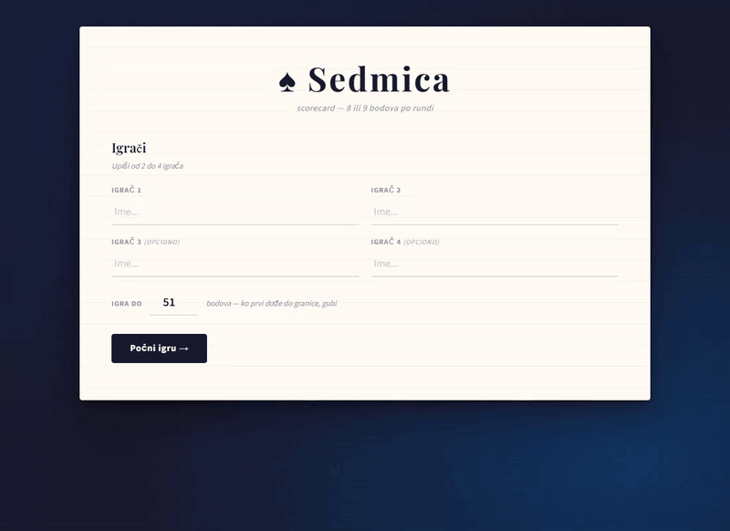
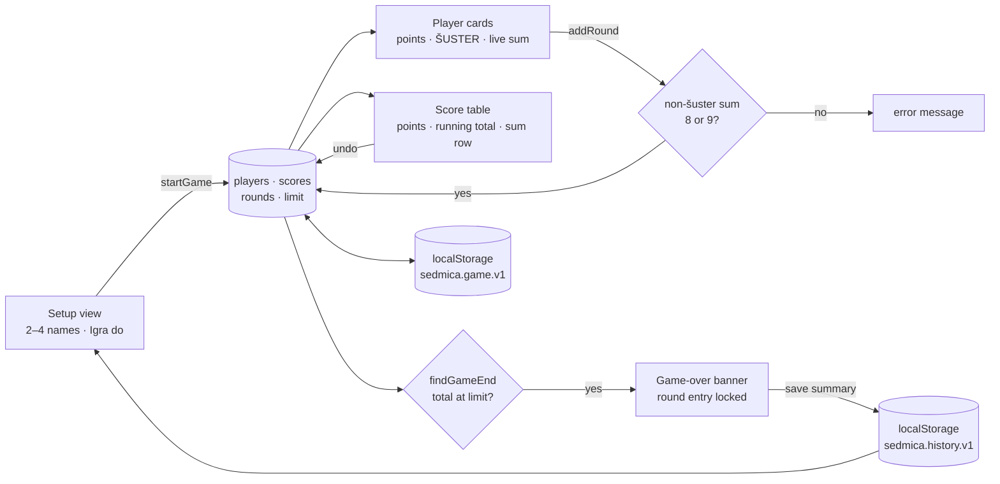
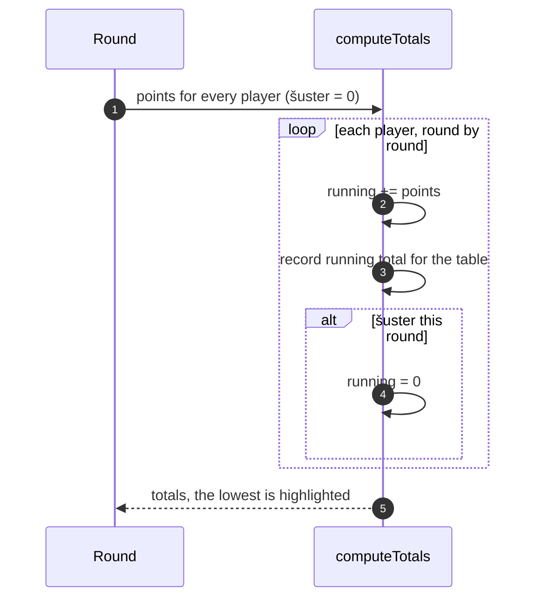
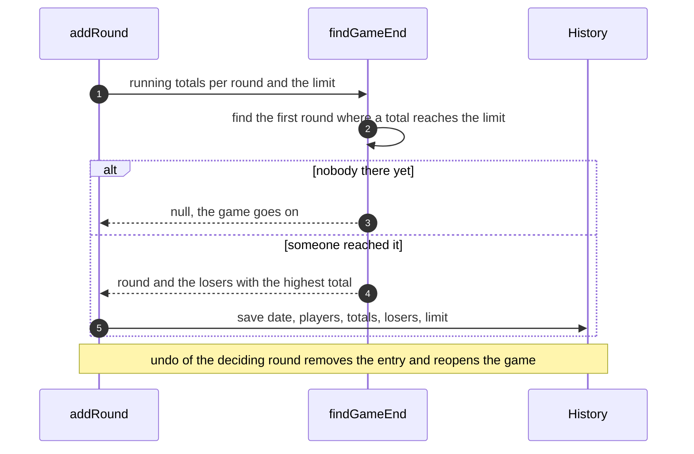

<div align="center">

# ♠ Sedmica Score Table

[](https://github.com/pero-grubac/sedmica/actions/workflows/ci.yml)
[](https://github.com/pero-grubac/sedmica/actions/workflows/deploy.yml)


**A scorecard for the card game Sedmica: 2–4 players, a live 8-or-9 check for every round, the šuster rule, running totals, a configurable end of game and a history of past games.**

[](https://pero-grubac.github.io/sedmica/)



</div>

---

## 📌 Project Overview

**Sedmica Score Table** keeps score for **Sedmica**, a Balkan card game for two to four players. Every round the players' points must add up to 8 or 9; a player can be marked **šuster**, which scores them 0 for the round and resets their running total. The first player whose running total reaches the limit (51 by default) loses.

The interface is in Bosnian/Serbian/Croatian. It runs entirely in the browser with no build step and no dependencies, keeps the game if the page is reloaded, and installs as an offline PWA.

---

## ✨ Features

- 👥 **2–4 players**; players 3 and 4 are optional, names must be different
- 🏁 **Igra do**: the game is played to 51 by default, or any whole number from 11 up; the limit is shown under the title and next to the table
- 🃏 **A card per player** with their points for the round and a **ŠUSTER** toggle
- ✅ **Live check**: "Zbir: 7 / 8–9" turns green when the round adds up to 8 or 9; šuster players are left out
- 💀 **Šuster rule**: 0 points for the round and the running total starts again from 0
- 📋 **Score table** with every round: the round's points and, smaller beneath them, the running total after it (`Σ 13`, or `↺ 0` for a šuster reset); the sum row highlights the lowest total
- 🔚 **End of game**: as soon as a running total reaches the limit, a banner names the loser and round entry is locked until **Nova igra** or an undo
- 📜 **Istorija**: finished games (and games reset after at least one round) are kept with date, players, totals, loser and limit, with per-player stats: games, losses and average final total
- ↶ **Undo the last round** if something was entered wrong; undoing the deciding round reopens the game
- ⌨️ **Keyboard**: the field is selected on focus, `Enter` adds the round
- 💾 **Survives a reload**: the game in progress (including its limit and an ended state) is kept in `localStorage` until **Nova igra**
- 📱 **Phone layout**: player cards two per row
- 📶 **Offline PWA** with self-hosted fonts

### 🃏 Rules (short)

| Rule | Description |
|------|-------------|
| Points per round | The players' points add up to **8 or 9** each round |
| End of game | The first player whose running total **reaches the limit** (default 51) loses. If several cross it in the same round, the highest total loses, and equal totals share the loss |
| Šuster | The player gets **0 points** that round and their running total resets to 0 |

---

## 🛠️ Tech Stack

| Technology | Usage |
|------------|-------|
| HTML5 + CSS3 | Layout and the paper-and-ink theme |
| Vanilla JavaScript | Players, validation, šuster logic, totals, rendering |
| `localStorage` | Game in progress (`sedmica.game.v1`), history of the last 50 games (`sedmica.history.v1`) |
| Playfair Display + Source Sans 3 | Self-hosted WOFF2 fonts |
| Web App Manifest + Service Worker | Install support, offline cache |
| `node:test` | Game logic, end-of-game rules, history and PWA integrity tests |
| Playwright | End-to-end smoke tests on a desktop and a phone viewport |
| Lighthouse CI | Performance, accessibility, best practices and SEO audit in CI |
| GitHub Actions + GitHub Pages | CI and deployment |

---

## 📁 Project Structure

```
sedmica/
├── index.html              Setup view with history, game-over banner, cards, score table, dialogs
├── style.css               Theme, cards, table, history, mobile rules
├── script.js               Rules (pure functions), rounds, šuster, end of game, history, persistence
├── service-worker.js       Offline cache (bypassed on localhost)
├── manifest.json           PWA manifest
├── assets/
│   ├── fonts/              Playfair Display, Source Sans 3 (WOFF2)
│   └── icons/              192 and 512 px app icons
├── tests/
│   ├── helpers.js          Runs script.js in a sandbox with a tiny DOM stub
│   ├── game.test.js        Setup, limit, 8/9 rule, šuster, end of game, undo, history, reload, escaping
│   ├── rules.test.js       Pure functions: limit, running totals, end detection, history, stats
│   ├── pwa.test.js         Precached files, manifest icons, fonts
│   └── e2e/                Playwright smoke tests and a tiny static server
├── playwright.config.js    Desktop and phone projects
├── lighthouserc.json       Lighthouse CI settings
├── readme_assets/demo.gif
├── package.json            npm scripts (start, test, test:e2e); Playwright as the only dev dependency
└── .github/workflows/
    ├── ci.yml              Unit tests, e2e tests and Lighthouse on pull requests and feature branches
    └── deploy.yml          Unit and e2e tests, then deploy to GitHub Pages
```

---

## 📦 Installation

You need [Git](https://git-scm.com/) and, for the tests and local server only, [Node.js](https://nodejs.org/) 20 or newer.

```bash
git clone https://github.com/pero-grubac/sedmica.git
cd sedmica
```

The app itself needs nothing installed. `npm install` is only for the end-to-end tests (Playwright).

---

## ▶️ Usage

### Run locally

```bash
npm start                      # http://localhost:8080
# or
python -m http.server 8080
```

The Service Worker does no caching on `localhost`, so changes show up on a normal reload.

### Play

1. Enter two to four names, optionally change **Igra do** (51 by default, at least 11), and press **Počni igru →**.
2. After each round type everyone's points. The counter next to the button shows the round's sum.
3. If a player is šuster, press **ŠUSTER** on their card.
4. Press **+ Dodaj rundu** (or `Enter`). A round that doesn't add up to 8 or 9 is refused with a message.
5. Under every score the table shows the running total after that round.
6. When someone reaches the limit the game ends and the loser is named. **↶ Poništi zadnju rundu** removes the last round (and reopens an ended game); **↺ Nova igra** starts over.
7. Past games and per-player stats are on the start screen under **Istorija**; **🗑 Obriši istoriju** deletes them after a confirmation.

### Run the tests

```bash
npm test                       # unit tests
npm install                    # once, for Playwright
npx playwright install chromium
npm run test:e2e               # smoke tests, desktop and phone
```

---

## 🏗️ Architecture



### Running totals with šuster



### End of game



---

## 🚀 CI/CD

| Workflow | Runs on | What it does |
|----------|---------|--------------|
| `ci.yml` | Every push (including `main`) and pull request | Three jobs: **unit** (`npm test`), **e2e** (Playwright smoke tests in Chromium on a desktop and a phone viewport, traces uploaded on failure) and **lighthouse** (Lighthouse CI on exactly the deployed files, report uploaded) |
| `deploy.yml` | After **CI passes on `main`**, or a manual run | Publishes the site's files to GitHub Pages; the tests already ran in CI |

Deploy is chained to CI (`workflow_run`): a push to `main` is tested once, and only a green run is published, from exactly the commit that was tested. Documentation-only commits start neither.

CI **skips documentation-only changes** (`*.md`, `readme_assets/`, `LICENSE`, `.gitignore`, `.vscode/`), and a newer run on the same branch cancels the older one. Only the site's files are deployed (`index.html`, `style.css`, `script.js`, `service-worker.js`, `manifest.json`, `assets/`).

**One-time setup:** **Settings → Pages → Build and deployment → Source** → **GitHub Actions**.

> **On every release** bump `CACHE` in `service-worker.js` (e.g. `sedmica-v4` → `sedmica-v5`). Page loads go to the network first and other files are refreshed in the background, so a new release shows up on the next visit; the new cache name clears the old files.

---

## 🧭 Design Decisions

- **Validate where mistakes happen.** The live sum shows a wrong round before it is added, and the 8/9 rule refuses it if it is added anyway.
- **Scores are stored per round**, and totals are recomputed from them, so undo and the šuster reset can never drift out of sync.
- **The rules are pure functions** (`parseLimit`, `runningTotals`, `findGameEnd`, `addToHistory`, `playerStats`), so the end of the game is decided from the stored rounds and tested without a browser. That is also why undo can reopen a finished game.
- **History entries carry the game's id**, so a finished game is never stored twice and an undone ending leaves the history.
- **Names are escaped** before they are rendered, so any name is safe to type.

---

<div align="center">

*Osam ili devet. Uvijek.*

</div>
